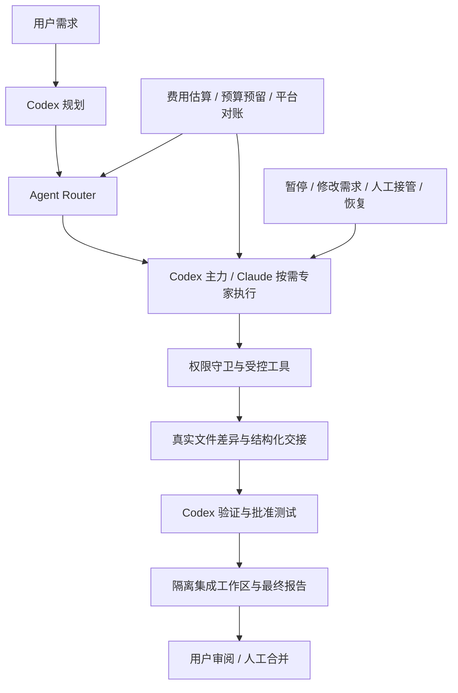

# Agent Team

**GPT/Codex 统筹，Claude 按需作为专家参与的本地软件开发协作框架。**

Agent Team 将一次开发需求串成可检查的流程：规划、任务分工、隔离开发、代码交接、独立验证、测试与人工审阅。它解决的不是“同时打开两个聊天窗口”，而是模型之间缺少可靠交接、权限边界、费用约束和失败恢复的问题。

多 Agent 的价值来自明确分工：Codex 保持主力，Claude 在设计、架构、算法、局部实现或独立审查有具体收益时参与。简单任务继续由一个 Agent 完成，预算充足不会成为增加调用的理由。

> 当前版本：**0.3.2，实验性 Windows 本地框架**。Native Developer 已在隔离小项目完成真实开发与验证；这不代表所有平台、CLI 版本、供应商或复杂项目都已验收。当前付费账单适配器及 Native 凭证桥针对 CaMeL。详见[验证边界](docs/VALIDATION.md)。

## 核心能力

| 组件 | 职责 |
|---|---|
| GPT Planner / Codex | 调查需求、规划分工、主要开发、工程决策和最终检查 |
| Claude Developer | 在明确文件范围内分析、设计、修改代码、实现局部模块 |
| Reviewer | 独立读取固定版本和差异，输出结构化审查意见，由 Codex 判断 |
| Task Router | 按具体收益选择通用开发、UI/前端、架构、算法、调试或审查流程 |
| Permission Guard | 检查文件范围、工具、任务版本、所有权及批准的测试命令 |
| Cost Monitor | 分开记录费用情景估算、保守预留、客户端回执与平台关联账单 |
| Human-in-the-loop | 暂停、修改需求、接管、交还、恢复；最终合并由人决定 |
| Git 隔离工作流 | 固定基准提交、独立 worktree、限定文件提交及独立集成验证 |

## 整体流程



Claude Native Developer 使用受控 Windows sandbox、短临时运行区和内存凭证桥。Read/Edit/Write 经过确定性守卫；授权测试通过专用 `mcp__agent_team__Bash` 接口交给**同一个 runner**，在无网络测试沙箱中执行批准的 argv。它不开放任意 shell，也不宣称直接 Git Bash/MSYS 已可在该沙箱运行。详见[架构与安全边界](docs/ARCHITECTURE.md)。

## 安装

需要 Python 3.12+、Git，以及具备本项目所需安全参数的 Codex CLI。实际模型工作使用你自行安装和认证的 CLI，本项目不附带这些二进制文件。

| 依赖 | 用途 |
|---|---|
| Windows | 当前完整 Native Developer 的支持平台 |
| Codex CLI | 使用已有 ChatGPT 官方订阅登录；不自动切换 OpenAI API 付费 |
| Claude Code CLI + 已有 CaMeL 配置 | 仅在明确授权付费参与时需要 |
| 已配置的 OpenCLI / Chrome 登录会话 | 当前 CaMeL 钱包、套餐及账户匹配读取；不会自动安装或登录 |

克隆后从源码安装（将占位符替换为实际 GitHub 账号）：

```powershell
git clone https://github.com/YOUR_GITHUB_ACCOUNT/agent-team.git
cd agent-team
py -3.12 -m pip install --user -e .
python -m agent_team --version
python -m agent_team doctor
```

也可直接使用 `python -m agent_team` 或 Windows 下的 `agent-team.cmd`，不要求更改系统 PATH。Python 运行时没有第三方包依赖；构建使用 setuptools。不要把框架安装到待修改的业务仓库内部。

`doctor` 检查本机能力和登录方式，不调用模型推理。不同 CLI 发布版本可能缺少安全参数，特别是 Windows 权限 profile 或预览参数；缺少能力时会拒绝运行。先检查 doctor 结果，不能通过关闭 sandbox 规避。供应商认证请参考各 CLI 的官方说明；不要把认证文件复制到本仓库。

## 配置与首次任务

### 1. 确认项目和测试

目标项目需要已有 Git 提交。测试命令由你确认，可以提供 JSON argv 数组，或放在项目自己的 `.agent-team.json` 中：

```json
{
  "version": 1,
  "test_commands": [["python", "test_greeting.py"]],
  "claude_budget": 1.0
}
```

其中 `claude_budget` 是可选的更小项目预算，不能扩大用户级授权。测试不可确定时不会将“没有运行测试”标成测试通过。[完整示例](examples/project-config.example.json)与[最小项目](examples/minimal-project/)可复制到独立目录使用。

### 2. 先用 GPT-only

以下从框架源码目录执行；将 `<PROJECT>` 替换为你的 Git 项目路径：

```powershell
python -m agent_team run --repo '<PROJECT>' `
  --request '完成这个小范围开发任务，保持既有行为，运行指定测试，交付供我审阅' `
  --tests-file examples/tests-python.json --policy gpt_only --watch
```

示例测试文件适用于最小 Python 项目；其他项目应提供自己的真实测试命令。`gpt_only` 完全禁止付费 Claude 调用。`--watch` 启动后台 runner 并连接实时公开事件；退出监控不会停止任务。

### 3. 明确授权多 Agent

先查看用户级预算，再按需要启动：

```powershell
python -m agent_team budget show
python -m agent_team run --repo '<PROJECT>' --request-file task.txt `
  --tests-file examples/tests-python.json --policy selective --use-default-budget --watch
```

任务文件使用 UTF-8。Selective 只在有实际收益和预算条件满足时安排 Claude；明确独立审查仍保持只读。更多角色、控制命令与恢复说明见[使用指南](docs/USAGE.md)。

### 4. Codex App 自然语言入口（可选）

先阅读 `codex/global-entry.md` 和 `codex/agent-team/SKILL.md`，确认接受路由规则与默认预算，再显式安装：

```powershell
python scripts/install-codex-entry.py --help
python scripts/install-codex-entry.py --install
```

安装器会先备份现有用户级指令和 Skill，保留无关规则；不修改项目 AGENTS、模型认证或计费渠道。安装后保留此克隆目录，Skill 通过安装元数据定位协调器。

以后可直接在目标项目的 Codex App 对话中说：

> 使用 Agent Team 完成这个开发任务，GPT 主导，Claude 必要时参与，运行本项目测试，完成后等我决定是否合并。

**明确多 Agent 意图会授权已配置的默认 Claude 预算**，因此先检查 `budget show`。普通任务没有该授权；明确“GPT-only”时始终禁用 Claude 费用。原生终端窗格需用户打开，实时记录也可在启动命令输出中查看。

## 预算与费用

可修改的初始策略为：普通任务 3、明确无人值守任务 8、上海自然日累计 15、月钱包累计 100，单位是 **CaMeL 平台美元等值额度**，不是现金支出或银行卡扣费。无人值守不会从任务复杂度自动推断。

```powershell
python -m agent_team budget set --task-default 3 --unattended-default 8 `
  --daily-default 15 --monthly-wallet-default 100
```

预算是上限，不是消费目标。预计情景区间、保守预留、Claude CLI 估算和平台关联账单分开保存；缓存样本或历史倍率不是未来保证。费用或余额未知、账户不匹配、额度不足时会阻断下一次付费调用。超额需要明确授权，不自动购买额度或升级到更贵模型。

**预算是客户端软限制。** CLI 估算不保证等于平台实际扣费，账单可能延迟；框架不会声称服务端硬额度已经设置。日预算、套餐重置窗口、月钱包、密钥额度和 Codex 订阅状态分别管理。当前财务适配器专用于 CaMeL，不应当作通用 Anthropic 账单 API。

## 安全设计

- 不自动 push、部署或合并目标项目主分支。`READY_FOR_MERGE` 表示交付待审阅。
- 模型在固定基准与独立 worktree 中工作；未提交修改留在原目录，不替其他会话提交。
- 凭证仅从已授权的本机配置读取并临时注入，日志执行脱敏；不把密钥写入代码或 Git。
- 保留 sandbox、受控工具、精确文件与测试白名单；不使用 bypassPermissions 或任意 shell。
- 暂停、版本与工作区所有权参与派发判断，人工接管后 Agent 不并行写入。
- 保存回执、提交和检查点；未知已付费结果不会自动再次调用。
- 本地日志、余额、真实账单和认证信息不应提交或粘贴到公开 Issue。见[安全说明](SECURITY.md)。

Git worktree 不是安全沙箱；CLI 安全能力及本机系统版本会影响边界。当前框架用于可信本地项目，不是对任意恶意代码的完整保密承诺。

## 开发与验证

```powershell
python -m unittest discover -s tests -v
python scripts/check-publication.py
```

公开测试里的模型和账单采用 Mock／合成数据；部分 Windows OS 边界测试需要已安装 Codex sandbox，缺少依赖时明确跳过。测试不会自动发起付费推理。手动真实验收脚本要求另行明确费用授权，不能靠测试通过宣称已经真实调用模型。

仓库不发布私有运行日志、实际账单、设备路径或旧开发历史。此前隔离项目的真实工程验收只说明对应范围可用，完整证据边界见[验证说明](docs/VALIDATION.md)。

## 开发背景

本项目用于探索：AI Agent 之间怎样以明确职责、可追踪交付、安全权限和成本约束，可靠协作完成软件开发任务。它是持续演进的工程实验，优先采用可验证的小步改进，避免把模型的“任务完成”回复当作交付证据。

欢迎通过[贡献指南](CONTRIBUTING.md)提交最小可复现问题与改进。采用 [MIT License](LICENSE)。
