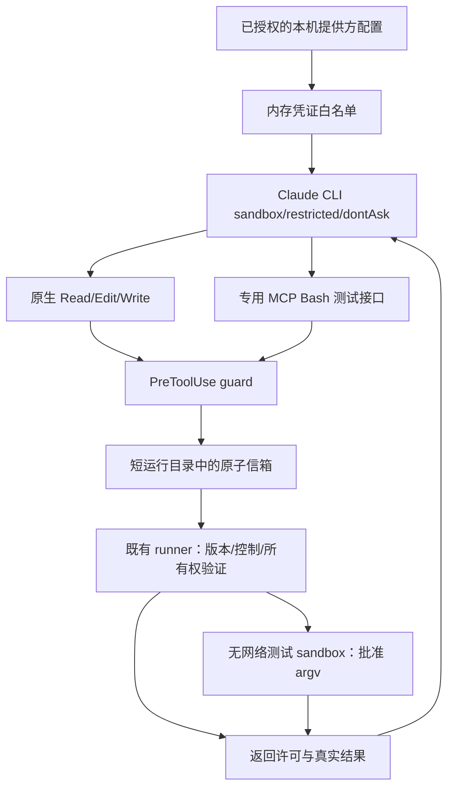

# 架构与边界

## 一个协调器，两类模型职责

`workflow.py` 驱动固定版本规划、专家阶段、开发、测试、审查、核验及隔离集成。`router.py` 选择角色与阶段；`adapters.py` 调用现有 CLI。Claude 不是第二个总调度器，子进程和受管 worktree 不能递归启动 Agent Team。

Codex 负责整体计划、主要开发与最后检查。Claude 在已授权的角色和精确文件范围内做设计、分析、实现或审查。模型的结构化输出与实际 Git 差异、工具回执及测试结果共同构成交付证据。

## 状态与控制

`store.py` 的 SQLite/WAL 保存任务、revision、所有权、调用、交接、费用及公开事件。派发与预算预留使用事务，重复 runner、过期 revision、人工所有权和未知已付费请求会被阻断。

暂停请求不等于已经暂停；实际受控进程和检查点决定结果。取消保留文件，人工接管需要所有权确认，恢复从原 Task ID 继续。原代码目录的未提交修改不自动复制进任务。

## Native Developer 工具链

运行目录是每次调用独立的短临时目录，避免 Windows 原子请求文件过长。policy 只读，只有必要运行子目录可写；CLI 树结束后清理。持久 state-dir 仍在外部，不授予 Agent 直接 SQLite 权限。

测试接口只是 stdio MCP 到原信箱的适配层，不是独立调度器或宿主网络服务。它只接受 schema 中的精确测试命令，拒绝未知工具、额外参数与任意 shell。直接 Git Bash/MSYS 与当前 Windows sandbox 不兼容，因此不用关闭 sandbox 作为兜底。

`StructuredOutput` 只接受角色 schema 的 JSON，没有文件或命令权限。CLI 内部格式化尝试仍受预算、turn 和工具上限约束；不等于失败后外部再次派发。

## 费用

`cost_monitor.py` 分开处理情景估算、保守预留、客户端回执、平台关联账单和资金来源。完整用量与唯一请求组合才关联费用；不确定数据保持未知，不能凭金额接近认领账单。

上海自然日、套餐窗口、月钱包、密钥额度与 Codex 订阅彼此独立。账本覆盖共享该 state-dir 的任务，不包含所有手动工具或其他状态库。

## 依赖限制

完整 Native 执行面向 Windows 和当前支持的 Codex 权限能力；Native 提供方白名单与财务适配面向 CaMeL。OpenCLI/Chrome 登录是独立可选依赖，框架不安装或导出其认证。没有覆盖所有 CLI 版本、所有操作系统或恶意代码执行场景。
